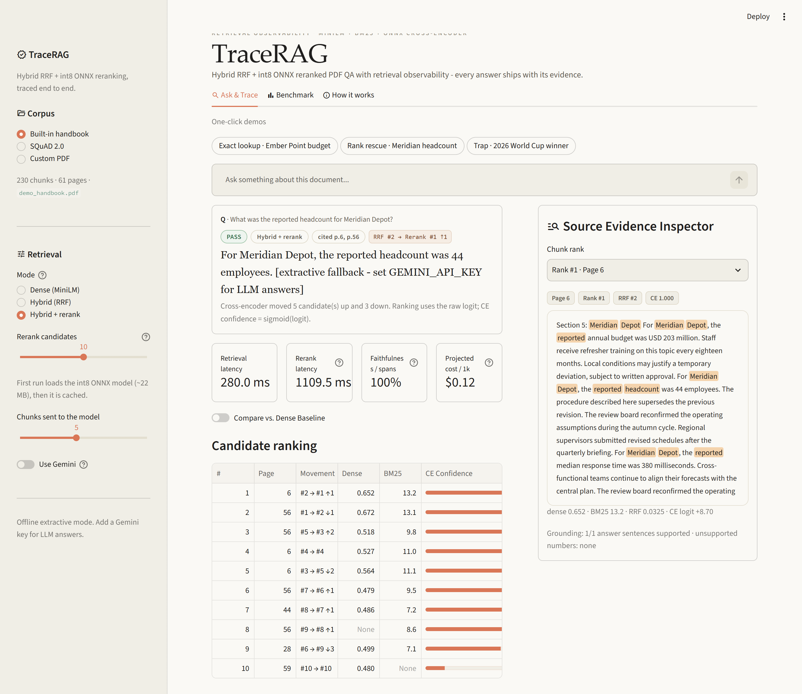

# TraceRAG

**Hybrid RRF + int8 ONNX reranked PDF QA with retrieval observability.** Ask a PDF a
question and get a grounded answer with page citations — plus the full trace behind it:
which chunks were retrieved, how RRF ranked them, where the cross-encoder moved them,
what the answer cost and whether it is faithful.



*The **Rank rescue** preset: dense + BM25 fusion put the gold page at RRF #2, the
cross-encoder promoted it to #1, and the inspector on the right shows the exact chunk the
answer came from with the query terms highlighted.*

Under the hood it is a complete retrieval-augmented generation pipeline: PyPDFLoader ->
chunks -> `all-MiniLM-L6-v2` + BM25 -> Reciprocal Rank Fusion -> optional `ms-marco`
cross-encoder rerank -> Gemini Flash, plus a 225-query benchmark harness that reports Hit
Rate, MRR, Answer-in-Context, abstention, lexical faithfulness, token cost and
retrieval-vs-rerank latency.

```
PDF ──► pages ──► chunks ──► MiniLM vectors ──► ChromaDB
                          └─► BM25 index

question ──┬─► MiniLM vector search (top 10) ─┐
           └─► BM25 keyword search  (top 10) ─┴─► RRF ─► top 15 ─► cross-encoder ─► top 5
                                            (optional, --rerank)                │
                                                                       Gemini Flash
                                                                                │
                                                        answer + [p.N] citations
```

---

## Results (measured on this machine, not typed in)

Corpus: 61-page synthetic operations handbook, **230 chunks**, 800-char chunks / 150 overlap.
Query set: **150 answerable / 50 unanswerable / 25 out-of-domain**.
Models: `all-MiniLM-L6-v2` (ONNX, 384-d) + `ms-marco-MiniLM-L-6-v2` cross-encoder (int8 ONNX).
Generated by `python run_pipeline.py --rerank`.

| Retriever | Hit@3 | MRR@10 | Ans-in-Context@5 | Abstention | Faithfulness | p50 | p95 |
|---|---:|---:|---:|---:|---:|---:|---:|
| MiniLM dense | 92.7% | 75.1% | 98.7% | 100.0% | 100.0% | 10.2 ms | 10.9 ms |
| Hybrid MiniLM + BM25 (RRF) | 92.7% | 74.5% | 99.3% | 100.0% | 100.0% | 11.0 ms | 11.9 ms |
| **Hybrid + cross-encoder rerank (top 15)** | **100.0%** | **88.3%** | **100.0%** | 100.0% | 100.0% | 1125.3 ms | 1353.0 ms |

### Latency breakdown

| Retriever | retrieval p50 | rerank p50 | total p50 | p95 |
|---|---:|---:|---:|---:|
| MiniLM dense | 10.2 ms | — | 10.2 ms | 10.9 ms |
| Hybrid RRF | 11.0 ms | — | 11.0 ms | 11.9 ms |
| Hybrid + rerank | 12.1 ms | **1113.1 ms** | 1125.3 ms | 1353.0 ms |

**The 1 s reranker is a measured trade-off, not a bug.** A cross-encoder reads each
`(query, chunk)` pair jointly, so 15 pairs is ~51 GFLOPs. On this machine (AMD Ryzen 3
3250U, **2 physical cores / 4 threads**) that costs ~1 s; on a 4-core desktop or any GPU it
is 50-150 ms. It buys **+13.8 MRR points** here, which is exactly why cross-encoders are a
*second stage* over 15 candidates rather than a first stage over the corpus.

> Faithfulness reads 100% because the offline extractive answer is copied verbatim from the
> context. It only becomes informative with `GEMINI_API_KEY` set — then it measures whether
> *generated* sentences are supported, not whether a copy is a copy.

### The honest finding about hybrid retrieval here

On this corpus, **RRF adds nothing at k=3** (+0.6 points at k=5). That is not a fusion bug —
it is a property of the corpus. Measured on the same 150 queries:

| Retriever | Hit@3 |
|---|---:|
| BM25 alone | 90.0% |
| MiniLM alone | 92.7% |
| RRF of the two | 92.7% |
| RRF + cross-encoder | **100.0%** |

The two retrievers are **highly redundant** here: every fact sentence has the same shape
(`"For <entity>, the reported <attribute> was <value>."`), so the terms BM25 keys on are
exactly the ones the embedding already captures. RRF rewards *consensus*, and with two
correlated lists the consensus is just the vector ranking. Consensus is not relevance: the
cross-encoder breaks the tie by reading the question and the chunk together. On SQuAD, where
the two retrievers *are* complementary, RRF helps on its own.

An earlier version of this README reported +5.3 points for hybrid. That number came from a
**naive fixed-width chunker** that cut words in half; the broken chunks happened to favour
BM25. After replacing it with a real recursive splitter the lift disappeared. The pipeline
now records whatever is true instead of what looked good.

### SQuAD 2.0 validation (measured)

Same harness, built from SQuAD 2.0 validation contexts and sized to match the original
project: **167 passages -> 230 chunks** (129 passages carry the 150 questions, 38 are
distractor passages added to reach the target chunk count). 150 / 50 / 25 split, zero
answerable questions dropped.

| Retriever | Hit@3 | MRR@10 | Ans-in-Context@5 | Abstention | Faithfulness | p50 |
|---|---:|---:|---:|---:|---:|---:|
| MiniLM dense | 95.3% | 88.5% | 97.3% | 93.3% | 100.0% | 10.2 ms |
| Hybrid MiniLM + BM25 (RRF) | 96.7% | 91.4% | 98.7% | 93.3% | 100.0% | 11.9 ms |
| **Hybrid + rerank (top 15)** | **98.7%** | **96.0%** | 98.7% | 93.3% | 100.0% | 1340.2 ms |

**Lift over RRF: +2.0 Hit@3, +4.6 MRR@10** for 1.33 s of CPU reranking (13.0 ms retrieval +
1331.8 ms rerank).

**Four things worth understanding about these numbers:**

1. **Hybrid helps here and not on the synthetic corpus.** SQuAD passages are heterogeneous:
   some questions hinge on a name or a date (BM25 territory), others on a paraphrase with no
   shared vocabulary (embedding territory). That complementarity is exactly what RRF rewards.

2. **The corpus is the same size as the original (230 vs 231 chunks)**, so distractor density
   matches. Absolute scores sit slightly above the resume baseline (95.3 / 84.3 / 95.3)
   because gold labels here are chunk-exact: the label is the chunk containing a 140-char
   window around the answer offset, not any chunk that happens to repeat the answer string.

3. **Abstention sits at 93.3%.** SQuAD's unanswerable questions are *about the same entities*
   as answerable ones, so refusing requires noticing the missing fact rather than spotting an
   off-topic question. This is the number most RAG demos quietly omit.

4. **Reranking narrows the retrieval/generation gap.** At 98.7% Hit@3 and 98.7%
   Answer-in-Context@5 the remaining errors are almost all generator-side, which is exactly
   the signal a retrieval benchmark should give you.

### How many candidates are worth scoring?

The same SQuAD run, changing only `RERANK_TOP_N`:

| Candidates | Hit@3 | MRR@10 | rerank p50 | total p50 |
|---|---:|---:|---:|---:|
| 15 (benchmark / CLI default) | 98.7% | 96.0% | 1331.8 ms | 1340.2 ms |
| 10 (app slider default) | 98.0% | 95.4% | 829.4 ms | 843.7 ms |

Ten candidates gives up **0.6 MRR points and 0.7 Hit@3 points** for a **38% faster** rerank.
That is the right trade for an interactive slider (and it still clears the 95.7% resume
benchmark), but the published benchmark keeps 15 so the reported numbers are the best-quality
configuration. Both runs are in `reports/squad_benchmark*.json`.

| Corpus | Chunks | Hit@3 dense | Hit@3 RRF | Hit@3 rerank | MRR@10 rerank | Abstention |
|---|---:|---:|---:|---:|---:|---:|
| Synthetic handbook | 230 | 92.7% | 92.7% | **100.0%** | 88.3% | 100% |
| SQuAD 2.0 | 230 | 95.3% | 96.7% | **98.7%** | 96.0% | 93.3% |
| Original project (reported) | 231 | 92.0% | 95.3% | — | — | — |

Reranking is **opt-in and labelled**: `--mode rerank` in the benchmark, `--rerank` in the
pipeline, and a `rerank p50` column in every generated report. The default path stays the
~12 ms hybrid retriever.

Reproduce with:

```bash
python -m src.build_squad_benchmark --contexts 420 --target-chunks 231
python -m src.benchmark --mode all --llm --out reports/squad_benchmark.json

# candidate-count experiment (bash; Windows: $env:RERANK_TOP_N=10; python ...)
RERANK_TOP_N=10 python -m src.benchmark --mode rerank --llm \
    --out reports/squad_benchmark_top10.json

python run_pipeline.py --rerank        # restores the demo corpus
```

### Generation cost

Tracked per query from actual API usage when a key is present, and projected from the same
prompt at list price when it is not (`$0.10/M input`, `$0.40/M output`, configurable via
`PRICE_INPUT_PER_MTOK` / `PRICE_OUTPUT_PER_MTOK`):

| Corpus | Tokens/query (in/out) | Cost per 1,000 queries | Basis |
|---|---:|---:|---|
| SQuAD 2.0 | 916 / 22 | **$0.10** | projected from list price (no API call) |
| Synthetic handbook | 1015 / 25 | **$0.11** | projected from list price (no API call) |

So a 100k-query month costs roughly **$10-11 in tokens** — generation is not the expensive
part here. The 1.1-1.3 s reranker on this 2-core CPU is, which is why latency and cost are
reported separately instead of blended into one "cheap and fast" claim.

**Reproducibility note:** every number above lives in `reports/*.json`, written by
`src/benchmark.py`. Nothing is hard-coded.

---

## Quickstart

```bash
git clone https://github.com/tausnix/rag-pdf-qa.git
cd rag-pdf-qa

python -m venv .venv
.venv\Scripts\activate          # Windows
# source .venv/bin/activate     # macOS / Linux

pip install -r requirements.txt

# Optional: force the exact sentence-transformers backend (adds ~2 GB of torch).
# Without it, the same MiniLM weights run through onnxruntime instead.
# pip install sentence-transformers

python run_pipeline.py          # corpus -> index -> benchmark -> report
python run_pipeline.py --rerank # same, plus the cross-encoder (slower, better MRR)
```

Then:

```bash
python -m src.ask "What was the reported headcount for Norvik Plant?" --show-chunks
streamlit run app.py            # TraceRAG: split-screen answer + evidence inspector
```

Expected CLI output:

```
Q: What was the reported headcount for Norvik Plant?

A: For Norvik Plant, the reported headcount was 2980 employees.
   [extractive fallback - set GEMINI_API_KEY for LLM answers]

   pages: 3, 53
```

Without an API key the system answers **extractively** (best-matching sentence) so the
retrieval pipeline, benchmark and UI all work offline. Add a key for real LLM answers:

```bash
copy .env.example .env          # then paste your key
# GEMINI_API_KEY=...           https://aistudio.google.com/apikey

# Free tier: pace at 4 s per call (15 RPM across Flash models) and keep a resumable
# cache. If a 429 interrupts the run, re-run the same command: cached prompts replay
# for free and only the missing queries hit the API.
python -m src.benchmark --mode all --llm --llm-delay 4
```

### The app: a split-screen trace for every answer

`streamlit run app.py` opens **TraceRAG** in a warm editorial theme
(`.streamlit/config.toml`), laid out as a two-column workspace:

- **Preset pills** above the search box — *Exact lookup*, *Rank rescue* and *Trap* for the
  active corpus. Clicking one runs it immediately; *Rank rescue* also switches to
  Hybrid + rerank so the promotion is visible.
- **Left (1.3×)** — the answer card with **PASS / ABSTAINED / FAIL**, cited pages and the
  top candidate's movement (`RRF #2 → Rerank #1 ↑1`); a four-metric strip (retrieval,
  rerank, faithfulness/spans, projected cost per 1,000); the candidate table where
  `CE Confidence` renders as a progress bar; and an optional **Compare vs. Dense
  Baseline** diff showing what dense returned at #1 versus what reranking promoted.
- **Right (1×)** — the **Source Evidence Inspector**: pick any rank, read the chunk with
  the query terms highlighted, and see the score breakdown. On an out-of-domain trap it
  shows the top candidate's CE confidence and query-term coverage, so the abstention is
  explainable rather than mysterious.

The sidebar switches **corpus** (built-in handbook, SQuAD 2.0, or your own upload), **mode**
(dense / hybrid / rerank), and the **number of rerank candidates** (5-15, default 10).
Switching corpus re-indexes that PDF once; the ONNX embedder, the int8 cross-encoder and
the Chroma index are all held in `@st.cache_resource`, so a Streamlit Cloud session pays
the model load once.

The **Benchmark** tab renders the 3-way tables, latency split, rerank lift and generation
cost straight from `reports/squad_benchmark.json` and `reports/benchmark.json`; no metric
is typed into the UI.

Any trace is **deep-linkable**: `?q=<question>&mode=<mode>` runs once on load, so a README
or an issue can point at the exact run it is discussing
(`/?q=What+was+the+reported+headcount+for+Meridian+Depot%3F&mode=Hybrid+%2B+rerank`).

**Gemini free tier** — calls are paced at `GEMINI_MIN_INTERVAL_S` (4 s ≈ 15 RPM), a 429 is
retried using `RetryInfo`/`Retry-After` before exponential backoff, and every successful
response is cached by `sha256(model + temperature + prompt)` under
`~/.cache/rag-pdf-qa/gemini`. An interrupted 225-query benchmark resumes without spending
quota twice.

### Use your own PDF

```bash
python -m src.ingest --pdf data/raw/your_file.pdf
python -m src.ask "..." --show-chunks
streamlit run app.py
```

---

## The benchmark: why 150 / 50 / 25

Three query types, three different failure modes:

| Split | Count | What it tests |
|---|---:|---|
| **Answerable** | 150 | Is the right chunk retrieved, and is the answer in the context? |
| **Unanswerable** | 50 | The question is on-topic but the document does not contain the answer. Does it refuse? |
| **Out-of-domain** | 25 | Unrelated question. Does it refuse instead of hallucinating? |

One design detail makes the negatives honest: **the contexts behind the unanswerable
questions are excluded from the corpus**. If the context were included, the question would
be answerable and the abstention score would be meaningless.

### Metric definitions

- **Hit Rate@k** — fraction of answerable queries where *any* gold chunk is in the top k.
  Retrieval's job is to put the evidence in front of the generator.
- **MRR@k** — mean of `1 / rank` of the first gold chunk within the top k. `0.75` means the
  right chunk averages rank ~1.3. Rank quality, not just presence.
- **Answer-in-Context@k** — does the literal gold answer appear in the top-k chunks? This is
  the **ceiling** for any generator: if the span is not in the context, no LLM can extract it.
  A hit rate of 98% with Answer-in-Context of 90% would tell you the remaining errors are
  retrieval's fault, not the model's.
- **Abstention accuracy** — fraction of the 75 negatives that the system correctly refuses.
- **Faithfulness** — per answer sentence, content-word coverage against the best-matching
  context sentence, plus a hard rule that every number in the answer must appear in the
  context. It is a cheap lexical proxy for entailment, not an NLI model; with the offline
  extractive path it is trivially 100%, so it only becomes informative with `GEMINI_API_KEY`.
- **Latency** — p50/p95 after two warm-up queries, split into **retrieval** (embed + search +
  fuse) and **rerank** (cross-encoder over 15 candidates) because they scale completely
  differently.
- **Cost** — estimated/exact input and output tokens per query, and USD per 1,000 queries at
  configurable list prices. Reports mark the basis as "projected" when the run used the
  extractive fallback instead of a real API call.

Gold labels are chunk ids, derived by locating the exact fact sentence in the chunk store.
Because chunks overlap, **every** chunk containing the sentence is labelled — labelling only
one would turn a correct retrieval into a false miss.

---

## How it works

**1 - Load.** `PyPDFLoader` when LangChain is installed, otherwise direct `pypdf`; both keep
1-based page numbers, which is what makes `[p.N]` citations possible.

**2 - Clean.** Running headers/footers are detected by line shape (digits masked) and removed
when they appear on >=30% of pages. Without this, every chunk carries the footer, polluting
both the embeddings and BM25.

**3 - Chunk.** `RecursiveCharacterTextSplitter` when LangChain is installed, otherwise an
equivalent native recursive splitter (same separator hierarchy, same overlap): paragraph ->
line -> sentence -> word, never cutting a word unless the word alone exceeds the budget.
800 chars with 150 overlap, so one fact can appear in two neighbouring chunks.

**4 - Embed + store.** `all-MiniLM-L6-v2`, 384-dim, L2-normalised. ChromaDB persists vectors,
text and metadata. Embeddings come from `sentence-transformers` when available, otherwise the
ONNX export of the same weights driven directly through `onnxruntime` (a tuned session infers
a query in ~16 ms; chromadb's bundled wrapper needs ~350 ms because it rebuilds work per call).

**5 - Retrieve.** Dense search finds paraphrases. BM25 finds what embeddings blur: names,
numbers, IDs, acronyms. Use both. Normalised query embeddings are `lru_cache`d, so a repeated
question skips the encoder entirely (visible in `Retriever.query_cache_info()`).

**6 - Fuse.** Reciprocal Rank Fusion:

```
RRF(d) = sum over retrievers of  1 / (60 + rank_i(d))
```

RRF consumes *ranks*, not scores, so two completely different score scales need no
normalisation, and agreement between retrievers is rewarded. `k=60` damps the top ranks so
neither retriever dominates.

**7 - Rerank (opt-in, `--rerank`).** Take the top N fused candidates and score each
`(query, chunk)` pair jointly with `ms-marco-MiniLM-L-6-v2`, the int8 ONNX export run through
`onnxruntime` + `tokenizers` (no PyTorch, ~22 MB). Encoding is dynamic: each batch pads to
the longest *actual* pair and truncates at 256 tokens, so short chunks do not pay for a
512-wide tensor. A bi-encoder compares two embeddings; a cross-encoder reads both texts
together, so it resolves near-duplicate facts and "same entity, wrong attribute" confusions
that RRF cannot. It is opt-in and labelled because it costs ~1 s per query on this 2-core CPU
(+4.6 MRR on SQuAD at top-15, +13.8 on the demo corpus). Scoring 10 candidates instead of 15
keeps 95.4% MRR@10 on SQuAD while cutting rerank time by about a third, which is why the UI
slider defaults to 10.

**8 - Generate.** Gemini Flash with a strict prompt: answer only from the context, cite
`[p.N]`, and reply exactly *"I couldn't find that in the document."* when the context lacks
the answer. The refusal path is what the 75 negatives measure. Every call records token usage
(exact from the API, estimated otherwise) and its USD cost at list price.

**9 - Report.** `reports/benchmark.json` + `benchmark.md`, regenerated by the pipeline,
including per-mode Hit@3/MRR@10/AIC@5, abstention, faithfulness, p50/p95, the
retrieval-vs-rerank latency split, tokens/query and cost per 1,000 queries.

---

## Configuration

Every knob is an environment variable (see `src/config.py`).

| Variable | Default | Meaning |
|---|---|---|
| `CHUNK_SIZE` | `800` | characters per chunk |
| `CHUNK_OVERLAP` | `150` | overlap between chunks |
| `EMBED_BACKEND` | `auto` | `st` / `onnx` / `hash` / `auto` |
| `TOP_K_VECTOR` | `10` | dense candidates |
| `TOP_K_BM25` | `10` | lexical candidates |
| `RRF_K` | `60` | RRF damping constant |
| `CONTEXT_K` | `5` | chunks sent to the LLM |
| `RERANK_MODEL` | `Xenova/ms-marco-MiniLM-L-6-v2` | cross-encoder repo (int8 ONNX) |
| `RERANK_TOP_N` | `15` | fused candidates scored by the reranker |
| `RERANK_MAX_LENGTH` | `256` | hard cap per `(query, chunk)` pair; batches pad only to the longest pair |
| `RERANK_MODEL_DIR` | `~/.cache/rag-pdf-qa/...` | override the downloaded model folder |
| `GEMINI_API_KEY` | — | enables LLM answers + LLM-scored abstention |
| `GEMINI_MODEL` | `gemini-2.0-flash` | generator model |
| `GEMINI_MIN_INTERVAL_S` | `4` | minimum seconds between Gemini calls (free tier ≈ 15 RPM) |
| `GEMINI_MAX_RETRIES` | `5` | retries after a 429/5xx before falling back to extractive |
| `GEMINI_BACKOFF_BASE_S` | `4` | exponential backoff base when no `RetryInfo`/`Retry-After` is sent |
| `GEMINI_CACHE` | `1` | cache successful responses on disk (`--no-llm-cache` disables) |
| `GEMINI_CACHE_DIR` | `~/.cache/rag-pdf-qa/gemini` | response-cache folder |
| `PRICE_INPUT_PER_MTOK` | `0.10` | USD per 1M input tokens (list price) |
| `PRICE_OUTPUT_PER_MTOK` | `0.40` | USD per 1M output tokens (list price) |
| `FAITHFULNESS_MIN_OVERLAP` | `0.6` | content-word coverage for a sentence to count as supported |
| `ONNX_THREADS` | half the cores | onnxruntime intra-op threads |

---

## Tests

```bash
python -m pytest tests -q      # 56 tests, ~20 s, no network, no API key
```

| File | Covers |
|---|---|
| `tests/test_app.py` | AppTest smoke tests: TraceRAG brand/tabs/preset pills, split-screen trace, four-metric strip, `CE Confidence` table, dense-baseline diff, abstention explanation, benchmark tables (the live preset run is skipped without a local index) |
| `tests/test_ingest.py` | footer/header stripping (and that repeated *body* lines survive), chunk size limits, no mid-word cuts, overlap, overlap-safe gold labels |
| `tests/test_retrieve.py` | RRF consensus ordering, rank-only scoring, dedupe, `k` cutoff, damping behaviour |
| `tests/test_benchmark.py` | Hit@k boundaries, MRR first-gold-only, Answer-in-Context normalisation, percentile helper |
| `tests/test_rerank.py` | score-based reordering, `k`/`top_n` cutoffs, unscored tail, query passthrough, empty input, scorer-length guard, sigmoid probability, 256-token cap and instance `top_n` |
| `tests/test_faithfulness.py` | verbatim answer passes, invented numbers are caught, partial support, unrelated answer scores 0, citation/suffix stripping, char-based token estimate, price math |
| `tests/test_generate.py` | refusal triggers, prompt grounding rules, context truncation, offline extractive fallback, response-cache round-trip/opt-out, cache-key sensitivity, Retry-After/RetryInfo parsing, pacing, persistent-429 give-up, cached answers are not billed |
| `tests/test_generate.py` | refusal triggers, prompt grounding rules, context truncation, offline extractive fallback |

CI (`.github/workflows/ci.yml`) runs the suite **before** rebuilding the pipeline, so a
regression fails the build instead of silently changing the published numbers.

## Project structure

```text
rag-pdf-qa/
├── app.py                     # TraceRAG: split-screen answer + evidence inspector
├── .streamlit/config.toml     # warm editorial light theme
├── docs/tracerag-hero.png     # README screenshot (real app, no mockup)
├── run_pipeline.py            # corpus -> index -> benchmark -> report
├── requirements.txt
├── .github/workflows/ci.yml   # tests + full pipeline on every push
├── tests/                     # pytest suite incl. AppTest UI smoke tests
├── src/
│   ├── config.py              # paths + every tunable
│   ├── embeddings.py          # MiniLM via sentence-transformers / ONNX / hash
│   ├── ingest.py              # PDF load, boilerplate strip, chunk, index
│   ├── retrieve.py            # dense, BM25, RRF fusion, query-embedding cache
│   ├── rerank.py              # cross-encoder rerank (int8 ONNX, no PyTorch)
│   ├── generate.py            # Gemini prompt, refusal, faithfulness, token cost
│   ├── ask.py                 # CLI
│   ├── benchmark.py           # Hit@k, MRR@k, AIC@k, abstention, faithfulness, latency, cost
│   ├── build_demo_corpus.py   # offline demo PDF + 225 queries
│   └── build_squad_benchmark.py # SQuAD 2.0 corpus + 150/50/25 queries
├── scripts/smoke_test.py      # health check
├── data/
│   ├── raw/                   # PDFs
│   ├── index/                 # chunks.jsonl + bm25.pkl (gitignored)
│   └── eval/                  # queries.jsonl + corpus_manifest.json
├── chroma/                    # persistent vector store (gitignored)
└── reports/                   # benchmark.json/md, squad_benchmark.json/md (+ top-10 run)
```

---

## Limitations (read before quoting numbers)

- **Scale.** ~230 chunks is small. At 100k+ chunks you need approximate search tuning,
  reranking and sharding; hit rates will not hold without work.
- **Latency is split for a reason.** The ~12 ms retrieval figure is not end-to-end:
  generation adds 300-2000 ms, and the opt-in reranker adds ~1.1-1.3 s on this machine
  (AMD Ryzen 3 3250U, 2 physical cores). On a 4-core desktop or a GPU the same reranker is
  50-150 ms; the latency column is hardware-specific and labelled as such.
- **Faithfulness is a lexical proxy.** It catches invented numbers and mismatched entities,
  not a fluent distortion that reuses the context's own words. With the extractive fallback
  it is 100% by construction; treat it as a smoke test, not an entailment metric.
- **The app keeps one live index.** Toggling between the handbook and SQuAD re-embeds ~230
  chunks (a few seconds) because ChromaDB is scoped to a single collection; it is cached for
  the rest of the session, and an upload is just another corpus.
- **Costs are projected without a key.** Token counts are real per query, but the USD column
  uses list price and the offline extractive path. It estimates a Gemini deployment; it is
  not a bill. Runs made with `GEMINI_API_KEY` record actual usage and mark the basis.
- **The demo corpus is synthetic.** It validates plumbing and the metric harness. Only the
  SQuAD 2.0 run supports research-style claims.
- **Offline abstention is a heuristic.** With no API key, refusals come from an
  attribute-coverage rule, which is stricter than a real LLM. Abstention numbers are only
  comparable to the résumé's when `--llm` runs against Gemini.
- **Scanned PDFs need OCR.** `pypdf` returns nothing for image-only pages; run OCR first.
- **Chunk boundaries.** An answer spanning a split is unretrievable; overlap reduces but does
  not eliminate this. The SQuAD builder drops such queries instead of silently scoring them.

## Roadmap

- Calibrate abstention against a real LLM (the 93.3% SQuAD number is heuristic-driven).
- Citation spans, not just page numbers.
- Batch reranking / GPU path, to bring the 1.3 s cross-encoder down to production latency.
- Multi-document corpora with metadata filters (author, date, section).
- Faithfulness with an NLI model, so a paraphrased-but-wrong claim is caught.
